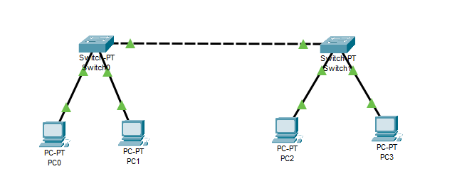
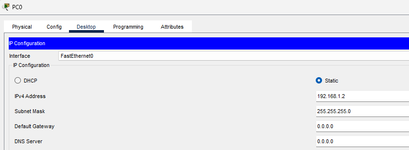
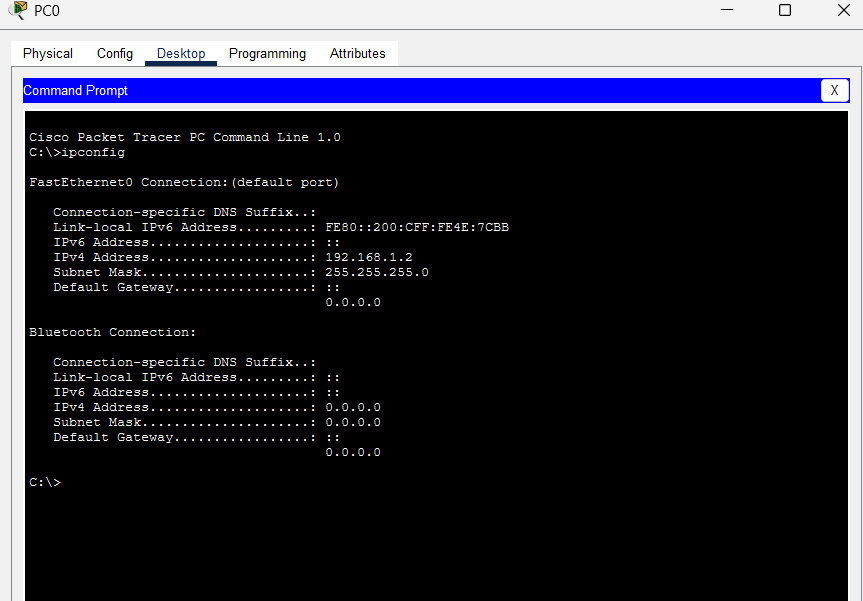
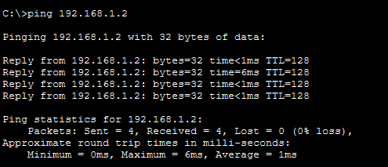
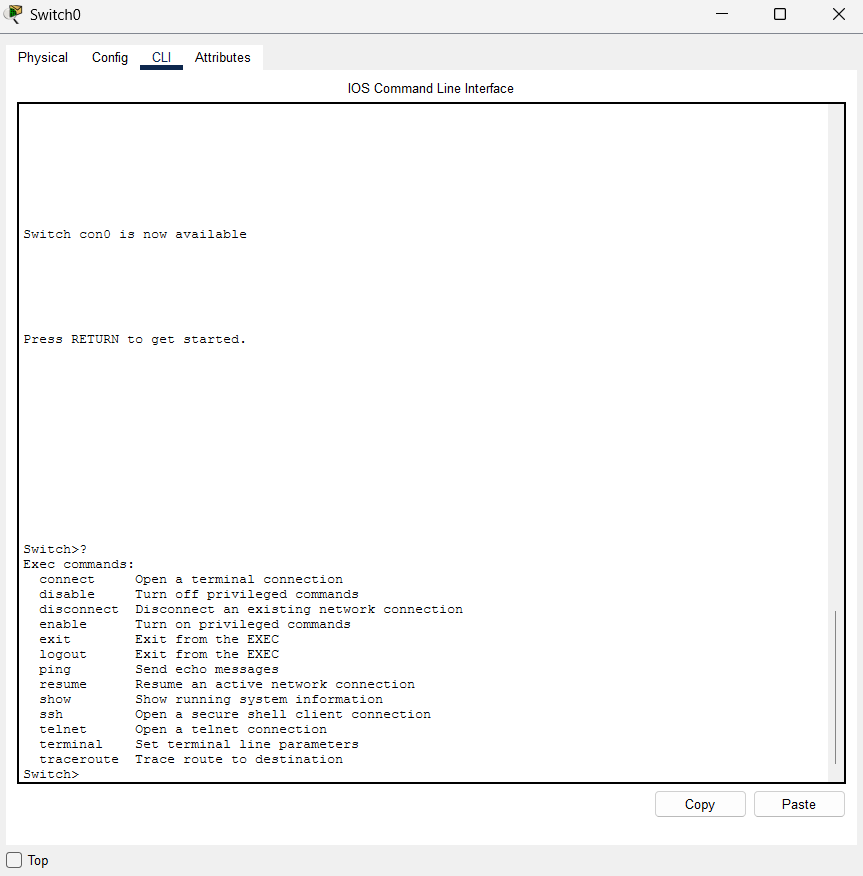
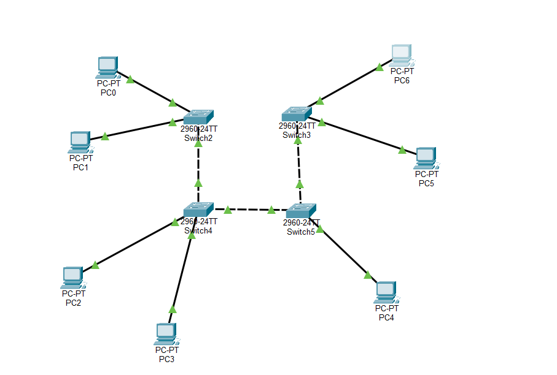
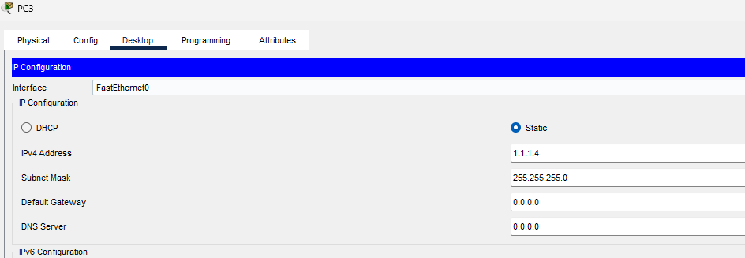
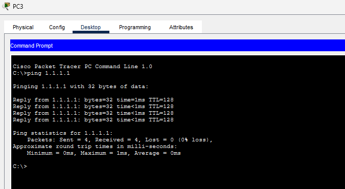

Министерство образования Республики Беларусь

Учреждение образования

“Брестский Государственный технический университет”

Кафедра ИИТ

       

Лабораторная работа №4

По дисциплине “Аппаратное и Программное обеспечение сетей”

Тема: “изучение пакета CISCO PACKETTRACER. начальная конфигурация маршрузитора CISCO”

Вариант: 1

     

Выполнил:

Студент 3 курса

Группы ИИ-28

Артыш.Е.А.

Проверила:

Кулик А.Д.

     

Брест 2026

# Цель

    Изучить интерфейс эмулятора Cisco Packet Tracer, научиться добавлять и соединять сетевые устройства, настраивать IP-адресацию на ПК, проверять связность командой ping, а также изучить начальную конфигурацию маршрутизатора Cisco и принципы работы таблицы маршрутизации.

# Ход работы 
    
Практическая часть 1

    В рабочей области Packet Tracer были добавлены два коммутатора Switch-PT (Switch0, Switch1) и четыре персональных компьютера (PC0–PC3). Устройства соединены кабелями типа Copper Straight-Through / Copper Cross-Over согласно схеме.
  

|Устройство|IP-адрес|Маска подсети|
|----------|--------|-------------|
|PC0|192.168.1.2|255.255.255.0|
|PC1|192.168.1.3|255.255.255.0|
|PC2|192.168.1.4|255.255.255.0|
|PC3|192.168.1.5|255.255.255.0|

Настройка выполнялась через вкладку Desktop → IP Configuratio

Сохранение произвденно в src

Вывод команды ipconfig с одного  ПК:

С компьютера PC3 была выполнена проверка связи с PC0 командой ping 192.168.1.2

Работа с CLI коммутатора/маршрутизатора

    Был открыт интерфейс командной строки коммутатора через вкладку CLI. Проверен список доступных команд с помощью ?.

    Задание для самостоятельной работы

топология по рисунку

мой вариант 1 так что таблица будет выглядеть как  

|Устройство|IP-адрес|Маска подсети|
|----------|--------|-------------|
|PC0|1.1.1.1|255.255.255.0|
|PC1|1.1.1.2|255.255.255.0|
|PC2|1.1.1.3|255.255.255.0|
|PC3|1.1.1.4|255.255.255.0|
|PC4|1.1.1.5|255.255.255.0|
|PC5|1.1.1.6|255.255.255.0|
|PC6|1.1.1.7|255.255.255.0|

!

Проверьте работоспособность сети с использованием ping

Вывод:

    В ходе лабораторной работы были изучены основные возможности эмулятора Cisco Packet Tracer и получены практические навыки построения и настройки локальной сети.