# МИНИСТЕРСТВО ОБРАЗОВАНИЯ РЕСПУБЛИКИ БЕЛАРУСЬ
# УЧРЕЖДЕНИЕ ОБРАЗОВАНИЯ
# “БРЕСТСКИЙ ГОСУДАРСТВЕННЫЙ ТЕХНИЧЕСКИЙ УНИВЕРСИТЕТ”
Кафедра «Интеллектуальные информационные технологии»

**ЛАБОРАТОРНАЯ РАБОТА №3**
по дисциплине «Аппаратное и программное обеспечение сетей»
за 4 семестр

**Тема:** «Анализ сетевого трафика и протоколов на базе Wireshark»
**Вариант 7**

Выполнил: студент 3 курса группы ИИ-28 (1 подгруппа) Заремская Е.П.
Проверил: Кулик А.Д.

Брест 2026

---

### Цель работы
Изучить возможности и приёмы работы со сниффером Wireshark, освоить типы фильтрации трафика, правила построения фильтров и приёмы статистической обработки сетевого трафика, а также на практике проанализировать работу протоколов Ethernet, IP, TCP, UDP, ICMP и ARP.

### Ход работы

### Задания:
1. Изучить краткие теоретические сведения по возможностям и приёмам работы с программой Wireshark (файл netWS.pdf).
2. Изучить типы фильтрации трафика, правила построения фильтров и приёмы статистической обработки сетевого трафика в Wireshark.
3. Запустив Wireshark на захват, выполнить загрузку доступной в лабораторных условиях страницы (bstu.by, iit.bstu.by или др.). Остановить и сохранить захват. Для захваченных пакетов определить статистические данные:
    * процентное соотношение трафика разных протоколов в сети;
    * среднюю скорость кадров/сек;
    * среднюю скорость байт/сек;
    * минимальный, максимальный и средний размеры пакета;
    * степень использования полосы пропускания канала (загрузку сети).
4. Отфильтровать в захвате IP-пакеты. Определить статистические данные:
    * процентное соотношение трафика разных протоколов стека TCP/IP в сети;
    * средний, минимальный, максимальный размеры пакета.
5. Запустив Wireshark на захват, выполнить команду ping для IP-адреса соседней рабочей станции. Сохранить результат. Сформировав нужный фильтр, отфильтровать пакеты, относящиеся к выполнению команды ping. На базе полученных пакетов и значений их полей интерпретировать результат работы утилиты ping. Описать все протоколы, используемые утилитой. Составить диаграмму взаимодействия машин при работе утилиты ping.
6. Запустив Wireshark на захват, выполнить разработанный в предыдущей лабораторной работе TCP-сервер и TCP-клиент. Сохранить результат. Сформировав нужный фильтр, отфильтровать пакеты данного сеанса. На примере любого TCP-сегмента указать структуру протокола TCP. Отметить поля заголовка, описать их и интерпретировать их значения. Составить диаграмму взаимодействия TCP-сервера и TCP-клиента.
7. Запустив Wireshark на захват, выполнить разработанный в предыдущей лабораторной работе UDP-сервер и UDP-клиент. Сохранить результат. Сформировав нужный фильтр, отфильтровать пакеты данного сеанса. На примере любого UDP-сегмента указать структуру протокола UDP. Отметить поля заголовка, описать их и интерпретировать их значения.
8. Выполнить анализ ARP-протокола по примеру из методических указаний.

---

### Решения задач:

#### 3. Захват и статистический анализ трафика при загрузке страницы bstu.by

**Процентное соотношение трафика разных протоколов в сети:**

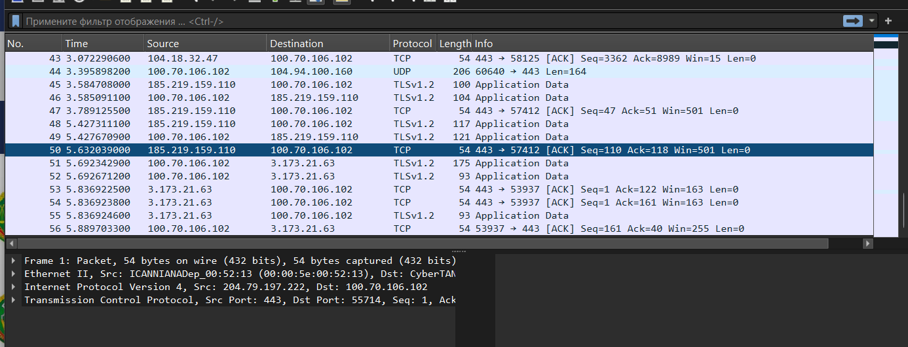

**Средняя скорость кадров/сек, средняя скорость байт в секунду:**

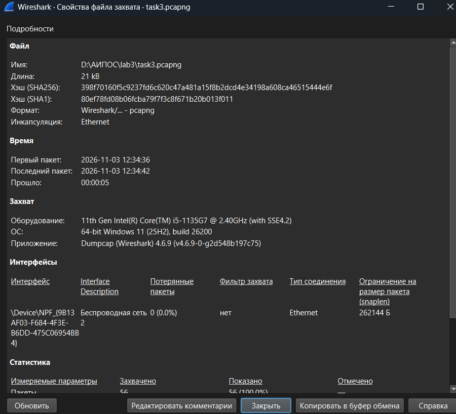

**Распределение пакетов по длине (минимальный, максимальный и средний размер):**

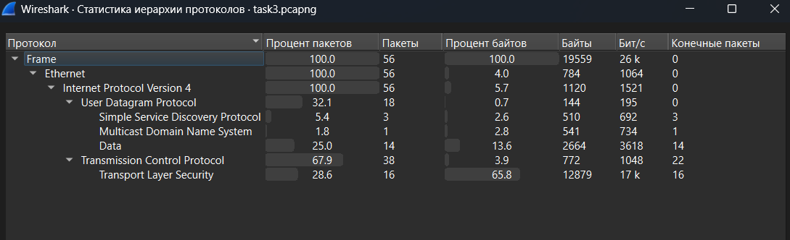

#### 4. Фильтрация IP-пакетов и анализ структур протоколов Ethernet и IP

Для выделения сетевого трафика был применен фильтр отображения `ip`.

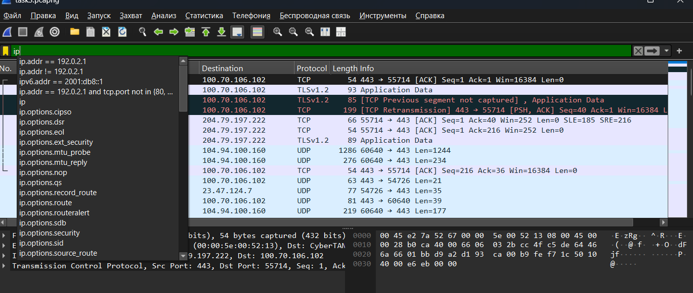

**Иерархия протоколов и процентное соотношение трафика:**

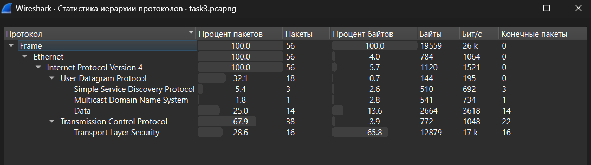

**Распределение пакетов по длине (минимальный, максимальный и средний размер):**

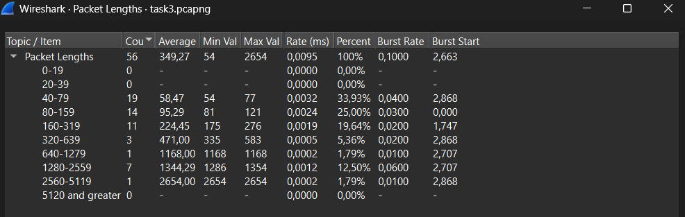

#### 5. Анализ работы утилиты ping и протокола ICMP

Для анализа работы утилиты ping был запущен захват трафика в Wireshark. С помощью команды `ipconfig` был определен основной шлюз лабораторной сети.

```text
Адаптер беспроводной локальной сети Беспроводная сеть:
DNS-суффикс подключения . . . . . :
Локальный IPv6-адрес канала . . . : fe80::3b8a:aaf8:bc0:326e%15
IPv4-адрес. . . . . . . . . . . . : 100.70.106.102
Маска подсети . . . . . . . . . . : 255.255.128.0
Основной шлюз. . . . . . . . . . : 100.70.0.1

В командной строке была выполнена команда ping 100.70.0.1. После получения 4 ответов захват был остановлен и сохранен.

C:\Users\USER>ping 100.70.0.1

Обмен пакетами с 100.70.0.1 по с 32 байтами данных:
Ответ от 100.70.0.1: число байт=32 время=94мс TTL=255
Ответ от 100.70.0.1: число байт=32 время=99мс TTL=255
Ответ от 100.70.0.1: число байт=32 время=51мс TTL=255
Ответ от 100.70.0.1: число байт=32 время=91мс TTL=255

Статистика Ping для 100.70.0.1:
    Пакетов: отправлено = 4, получено = 4, потеряно = 0 (0% потерь)
Приблизительное время приема-передачи в мс:
    Минимальное = 51мсек, Максимальное = 99 мсек, Среднее = 83 мсек

    Команда ping отправила 4 запроса и получила 4 ответа (0% потерь). Время отклика составило 51-99 мс. Значение TTL=255 указывает на то, что пакеты не проходили через промежуточные маршрутизаторы.

**Пакеты ICMP при выполнении команды ping (фильтр `icmp`):**

С помощью фильтра отображения `icmp` были выделены пакеты, относящиеся к утилите. Утилита ping использует протокол ICMP, который работает поверх протокола IP (сетевой уровень), а тот инкапсулируется в кадры Ethernet. Перед отправкой первого ICMP-пакета использовался протокол ARP для определения MAC-адреса шлюза.

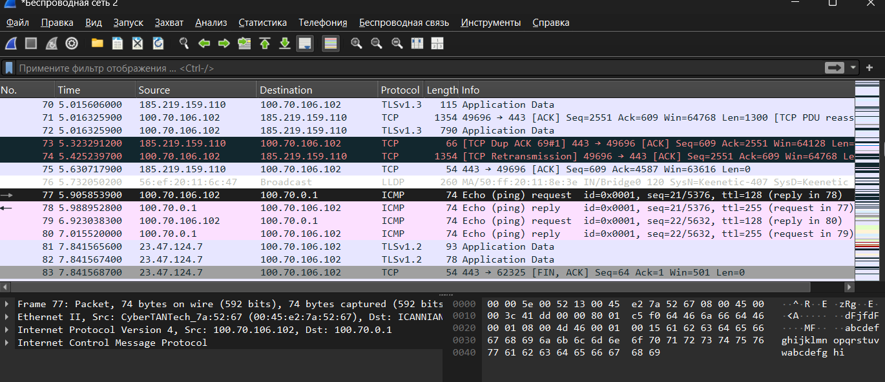

**Структура заголовка ICMP (Echo request):**

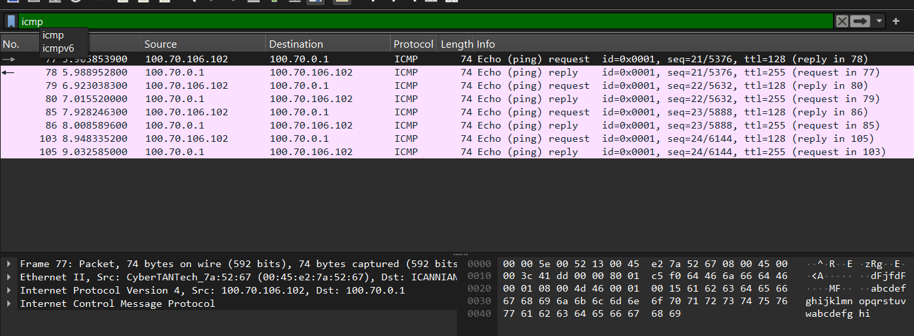

**Диаграмма взаимодействия узлов при работе утилиты ping:**

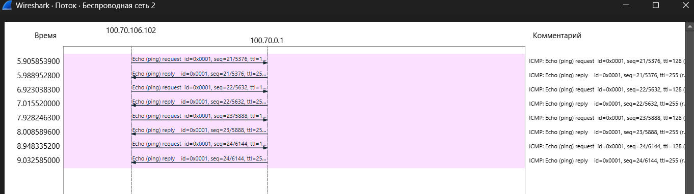

#### 6. TCP-сервер и TCP-клиент

**Код программы:**
*   [clientlab1.cpp](../src/clientlab1.cpp)
*   [serverlab1.cpp](../src/serverlab1.cpp)

Для анализа протокола TCP был запущен захват трафика на интерфейсе **Adapter for loopback traffic capture** (так как сервер и клиент запускались на одной машине). Затем был запущен разработанный TCP-сервер и TCP-клиент. В качестве фильтра отображения использовался `tcp.port == 666`.

**Структура TCP-сегмента:**

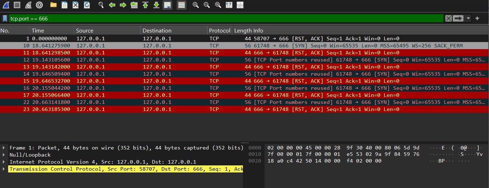
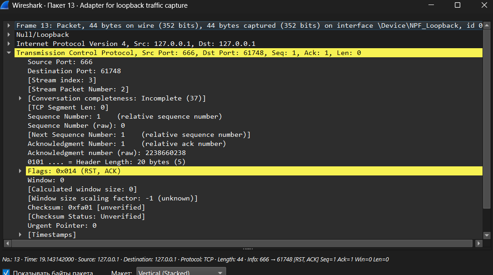

**Диаграмма взаимодействия TCP-сервера и TCP-клиента:**

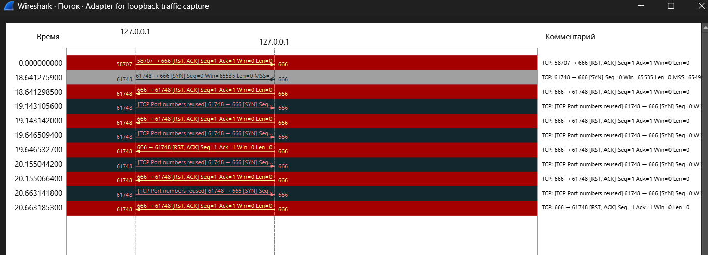

#### 7. UDP-сервер и UDP-клиент

**Код программы:**
*   [udpclientlab2.cpp](../src/udpclientlab2.cpp)
*   [udpserverlab2.cpp](../src/udpserverlab2.cpp)

Для анализа протокола UDP был запущен захват трафика. В качестве фильтра отображения использовался `udp.port == 666`.

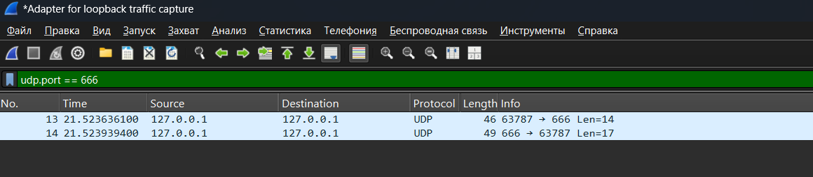
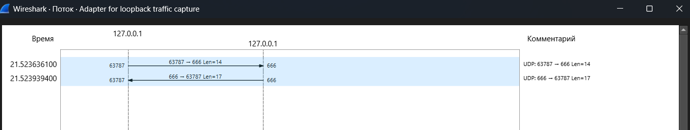

#### 8. Анализ ARP-протокола

Для исследования протокола ARP был запущен захват трафика на интерфейсе «Беспроводная сеть». Предварительно был очищен ARP-кэш командой `arp -d *`, чтобы принудительно инициировать широковещательный запрос. Затем с помощью команды `ping` был отправлен запрос на IP-адрес шлюза. В захвате были отфильтрованы пакеты с помощью фильтра `arp`. В результате были получены два пакета. В первом пакете (ARP Request) наша машина широковещательно запрашивает MAC-адрес шлюза. Второй пакет (ARP Reply) является ответом от шлюза, в котором он сообщает свой MAC-адрес.

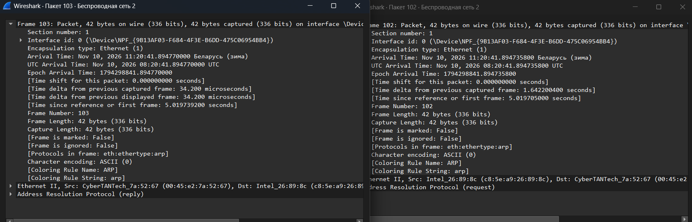

Вывод: в ходе лабораторной работы были изучены возможности и приёмы работы со сниффером Wireshark, освоены фильтры захвата и фильтры отображения, а также приёмы статистической обработки трафика. Практически выполнен захват трафика при загрузке web-страницы, работе утилиты ping, TCP- и UDP-клиент-серверных приложений; для каждого случая получены статистические характеристики и проанализированы структуры заголовков Ethernet, IP, ICMP, TCP, UDP и ARP с интерпретацией значений полей; по результатам захватов построены диаграммы взаимодействия узлов.